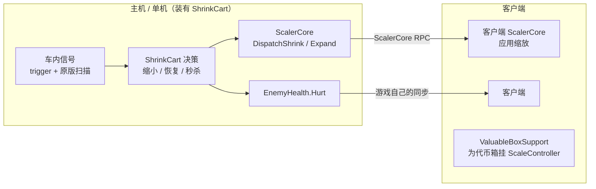
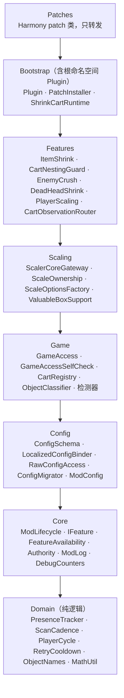
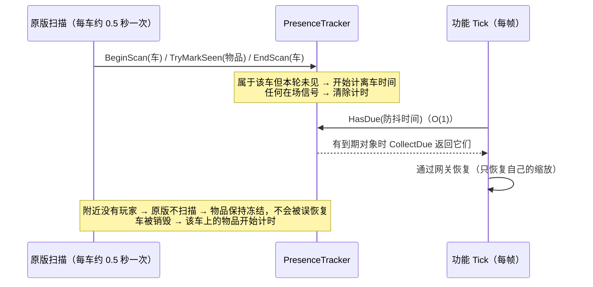
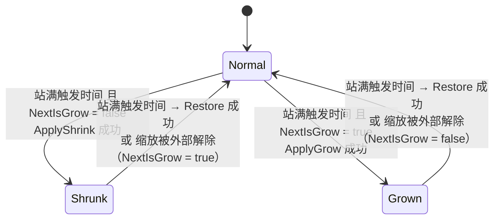

# ShrinkCart 架构

本文说明 ShrinkCart 0.3.1 起的架构：每一层负责什么、运行时各部分怎样协作、出错时怎样降级，以及扩展时要改哪些地方。
外部契约与内部接口签名见 [INTERFACES.md](INTERFACES.md)，环境搭建、更新流程与测试矩阵见 [MAINTENANCE.md](MAINTENANCE.md)，通用开发规则见 [REPO_Mod_Development_Guidelines.md](REPO_Mod_Development_Guidelines.md)。

## 1. 目标与非目标

**目标**

- 物品放进 C.A.R.T / 购物车后缩小，真正离车后恢复；按分类使用不同倍率。
- 可选的附加玩法：玩家站车循环缩放、死亡头颅进车缩小、敌人进车秒杀、车类物品不计入车内（车套车拦截）。
- 联机时只由主机做决策，缩放结果由 ScalerCore 同步。
- 可验证：游戏或依赖更新导致的断裂，要在构建期或启动时被发现，并且只影响对应功能。
- 热路径开销与车内物品数量基本无关。

**非目标**

- 不实现缩放本身（物理、碰撞、音频、同步都由 ScalerCore 负责）。
- 不在客户端做任何缩放决策，也不修改其他玩家的配置。
- 不修改游戏程序集，不发布游戏文件。

## 2. 运行环境与依赖

| 组件 | 版本 | 说明 |
|---|---|---|
| R.E.P.O. | v0.5.0（Unity 6000.3，Mono） | 编译时引用本机游戏的 `Assembly-CSharp.dll`（publicize 后的副本只在 `obj/`） |
| BepInEx | 5.4.23（BepInExPack 5.4.2305） | 插件入口、配置文件、日志 |
| HarmonyX | 2.9 | 运行时补丁（由 BepInEx 提供） |
| ScalerCore | ≥ 1.1.1 | 全部缩放行为与联机同步；行为契约见 [INTERFACES.md §3](INTERFACES.md#3-scalercore-契约) |
| REPOConfig | ≥ 1.2.7（`REPOModding-REPOConfig`） | 游戏内配置界面；ShrinkCart 不调用它的 API，只遵守它的显示约定 |
| 构建 | .NET SDK 10，目标 `netstandard2.1` | 单元测试 `net472`，构建工具 `net10.0` |

## 3. 网络模型



- **决策只在主机执行**：`Authority` 用 `SemiFunc.IsMasterClientOrSingleplayer()` 判定。判定抛出异常时按"非主机"处理（fail-closed）。所有主机侧功能在客户端上都不会激活。
- **状态只通过同步通道改变**：
  - 缩放由 ScalerCore 在主机派发，再通过它自己的 RPC 同步；
  - 秒杀调用游戏自己的 `EnemyHealth.Hurt`；
  - ShrinkCart 不发送自己的网络消息。
- **所有端都运行的部分**：
  - 车辆登记表：只是被动字典，客户端不使用。
  - `ValuableBoxSupport`：为代币箱挂上 `ScaleController`。ScalerCore 不会为代币箱创建控制器，客户端没有控制器就无法接收代币箱的缩放同步。
- **安装要求**：
  - 主机必须安装。
  - 客户端建议安装。没装 ShrinkCart 的客户端看不到代币箱的缩放，其他对象的缩放仍由 ScalerCore 同步（客户端需要装有 ScalerCore）。
  - 客户端自己的配置不影响主机的决策。

## 4. 分层与依赖

依赖只能从上往下指，箭头表示"引用"：



图中只画了相邻层，跨层向下引用同样允许，例如 Features 可以直接引用 Domain。

| 规则 | 保证方式 |
|---|---|
| 依赖只指向同层或更低层；新增命名空间必须先登记层次 | `BuildTools validate`（`LayerRules`） |
| Domain 只使用 BCL | `BuildTools validate`；单元测试以源码链接方式编入 Domain |
| Config 只使用 BCL 与 BepInEx | `BuildTools validate`；单元测试以源码链接方式编入 Config |
| 只有 `ScalerCoreGateway` 调用 `ScaleManager` | `BuildTools validate` |
| 对游戏非公开成员的访问只在 `GameAccess` 中，且与 `[GameMember]` 声明一致 | `BuildTools validate` + 启动自检 |
| 每个 patch 类位于 `ShrinkCart.Patches`，带 `[PatchFeature]`，目标唯一且参数可注入 | `BuildTools validate` |
| 不对 `UnityEngine.Object` 使用 `?.` / `??` / `is null` | Microsoft.Unity.Analyzers（UNT0007/0008/0029 为编译错误） |

## 5. 启动流程

`Plugin.Awake` 依次执行：

1. `ModLog.Initialize`：初始化日志，调试开关读取配置。
2. `ModConfig.Bind`：绑定配置并执行迁移，详见 §6。
3. `GameAccessSelfCheck.Run`：按 `[GameMember]` 声明核对游戏成员；缺失或类型变化的成员所属功能会被标为不可用。
4. `ValuableBoxSupport.RegisterHandler`：向 ScalerCore 注册代币箱 handler；失败时 `ValuableBoxSupport` 不可用。
5. `PatchInstaller.Install`：逐个 patch 类调用 `harmony.CreateClassProcessor(type).Patch()`；某个类失败时，它 `[PatchFeature]` 所属的功能不可用。
6. 创建 `ShrinkCartRuntime`（组合根），赋给 `ShrinkCartRuntime.Current`。
7. 输出启动摘要（一条 Info）：补丁安装数、缺失成员数、配置语言、不可用的功能及原因。

任一步骤抛出异常时，`Current` 保持为 `null`，插件整体停用：所有 patch 放行原版逻辑，并记录一条 Error。

## 6. 配置子系统

配置只使用 BepInEx 的公开 API，不再反射访问 `OrphanedEntries`。

**事实基础**（BepInEx 5.4.x）：

- 插件 `Awake` 时，文件里的值还在 ConfigFile 的孤儿条目中，`TryGetEntry` 只能查到已绑定的条目，所以读不到它们。
- `Bind` 会把孤儿值取进已绑定条目；`Remove` 只删除已绑定条目。
- 插件的 ConfigFile 构造时不写文件，所以在 `Bind` 之前检查 `File.Exists` 可以判断是否首次安装。

`ModConfig.Bind` 的步骤：

1. 记录 cfg 文件此前是否存在（用于判断首次安装），并在绑定期间设置 `SaveOnConfigSet = false`。
2. `RawConfigAccess.TryTake` 读出并删除存储的 `ConfigSchemaVersion`。做法是先用哨兵默认值 `Bind<string>` 读出原文，再 `Remove`。
3. 如果是升级（文件已存在且版本低于当前版本），先备份 cfg。
4. 读出配置语言，再由 `LocalizedConfigBinder` 按 `ConfigSchema` 的顺序绑定全部配置项：
   - 当前语言的键优先，另一种语言的键兜底，另一种语言的键随后被删除，所以切换语言不会丢值；
   - 绑定时传入的默认值总是声明的默认值。
5. `ConfigMigrator.ApplyRenamesAndCleanup`（每次启动都执行，幂等）：
   - 旧键继承：只有新键在 cfg 中没有值时才继承；
   - 删除废弃键。
6. 如果是升级，执行 `ConfigMigrator.MigrateToCurrent`，即一次性迁移：
   - 速度无条件统一为默认值；
   - 仍停在历史默认值的数值项升级为当前默认值。原因是 BepInEx 不会让已写入的值跟随默认值变化，早期安装、从没改过的玩家会一直停在旧默认值上。
7. 写入当前 schema 版本（该条目对 REPOConfig 隐藏）。
8. 数值规整为两位小数，并挂上写回时的规整处理，用来吸收滑条的浮点误差。
9. 挂上 `SettingChanged → ScalingConfigVersion++`，再统一保存一次。

## 7. 运行时模型

### 7.1 组合根与生命周期

`ShrinkCartRuntime` 持有全部服务与功能实例。patch 只通过 `ShrinkCartRuntime.Current` 调用它暴露的入口。

`ModLifecycle` 是唯一的生命周期编排者。每帧（`Plugin.Update`）执行：

1. `Authority.Poll`：主机判定，结果缓存 0.25 秒（按 unscaled time 计）。刚获得主机权限时补登记场上现有的车。
2. 对每个功能计算：

   ```text
   desired = 是主机 && 总开关「启用 ShrinkCart」 && 功能可用（含依赖） && 功能自己的配置开关
   ```

3. desired 由假变真时调用 `Activate`，由真变假时调用 `Deactivate(reason)`，reason 见下表。
4. 对已激活的功能调用 `Tick(now)`。节奏由功能自己决定，例如物品维护按 `ScanCadence`，玩家检测按「玩家检测间隔」。

此外，`ShrinkCartRuntime` 每秒清理一次已销毁的车（`CartRegistry.Prune`，并发出 `CartRemoved` 事件）；开启调试日志时，每 10 秒输出一次热路径计数。

| 功能 | 自己的配置开关 | 依赖 |
|---|---|---|
| ItemShrink | 启用购物车缩小 | Core, CartObservation |
| CartNestingGuard | 阻止车类物品计入车内 | Core, CartObservation |
| EnemyCrush | 敌人进车秒杀 | Core, CartObservation |
| DeadHeadShrink | 启用购物车缩小 && 启用死亡头颅进车缩小 | Core, CartObservation |
| PlayerScaling | 启用购物车缩小 && 启用玩家缩放 | Core, CartObservation |
| ValuableBoxSupport | 不是 `IFeature`：所有端运行，不受总开关和主机权限控制，只在自身可用时工作 | 无 |

`ValuableBoxSupport` 不受总开关控制，因为它自己不缩放任何东西，只让 ScalerCore 能处理代币箱。

| 事件 | 来源 | 行为 |
|---|---|---|
| 获得主机权限 | `Authority` 状态变化 | `CartRegistry.RegisterExisting()`，然后按 desired 激活功能 |
| 失去主机权限 | `Authority` 状态变化 | `Deactivate(AuthorityLost)`：只丢弃状态并放弃所有权，不恢复（客户端无法派发缩放） |
| 开关切换 | desired 变化 | `Deactivate(Disabled)`：恢复该功能施加的全部缩放 |
| 功能不可用 | 依赖失效或运行期异常 | `Deactivate(Unavailable)`：尽力恢复后停用 |
| 换关 | `RunManager.ChangeLevel` 的 Prefix | 已激活的功能执行 `ResetForLevel`（恢复并清空本关状态，保持激活）；然后清空车辆登记、分类缓存和计数器 |
| 卸载 | `Plugin.OnDestroy` | `Deactivate(Shutdown)`（恢复全部）→ `Current = null` → `UnpatchSelf` |

### 7.2 观察管线

游戏给出两类"车内"信号，由 `CartObservationRouter` 分发给各功能。

**trigger 在场信号**：`PhysGrabInCart.Add(PhysGrabObject)`

- 调用来源是车内 trigger 的 `OnTriggerStay`。原版只在主机上调用，频率为每个物理帧 × 每个未休眠的物体。
- **Prefix**：车套车拦截已激活、且物体属于车类时返回 `false`（跳过原版 `Add`），并用 `__state = true` 告诉 Postfix。Prefix 不修改任何列表。
- **Postfix**：
  1. `__state` 为真时直接返回；
  2. 没有任何车内功能激活时直接返回；
  3. 已跟踪的物体只刷新在场信号，一次字典查找后返回（快路径）；
  4. 新物体按分类缓存分发：敌人交给 EnemyCrush，可缩小物品交给 ItemShrink。死亡头颅只按原版扫描结果处理。

**原版扫描完成**：`PhysGrabCart.ObjectsInCart()`

- 这个方法每帧都会被调用。但原版只有在 12 m 内有玩家、并且 `objectInCartCheckTimer ≤ 0` 时，才真正扫描一次，扫描后把计时器重置为 0.5 秒。
- **Prefix**：记录 `__state = 计时器 ≤ 0`（且有车内功能激活）。
- **Postfix**：只有 `__state` 为真、并且计时器已经变为 `> 0` 时才处理，也就是原版刚完成一次真实扫描。处理顺序：
  1. 车套车清理：从 `itemsInCart` 移除车类物体，并按差值修正数量、总价和价格屏；
  2. `BeginScan`；
  3. 逐个处理扫描结果：已跟踪的物体标记在场，新物体按分类分发；
  4. `EndScan`。

**离车判定**（`PresenceTracker`，纯逻辑）：



物品离车后多久恢复（与 0.2.x 相同）：

```text
恢复延迟 = 距下一次真实扫描的时间（0–0.5 s） + 「离车防抖延迟」（默认 0.5 s）
         ≈ 默认 0.5–1.0 s，到期即恢复，不受「性能」分组影响
```

0.2.x 的做法是：每帧都把旧的 `itemsInCart` 列表里的物品重新标记为"在车内"，并在最后一次标记之后满防抖时间时准时恢复。0.3.1 在扫描发现物品不在车内时开始计时，同样准时恢复。两者的恢复时刻只差一帧左右，但 0.3.1 不再需要每帧遍历列表。

「性能」分组（`ScanCadence`）只控制其余的周期检查：目标是否销毁、是否被外部恢复、是否被装备，以及头颅是否进入提取点、卡车或不再处于触发状态。间隔如下：

| 当前跟踪数量 | 间隔 |
|---|---|
| 1–6 | 最小间隔 |
| 7–15 | 0.35 s |
| 16–30 | 0.75 s |
| 更多 | 最大间隔 |
| 0（空闲） | 最大间隔 |

- 分档结果最后都会被限制在 [最小间隔, 最大间隔] 之内。
- 关闭动态扫描时，固定使用最小间隔。

### 7.3 各功能

**ItemShrink（物品缩小）**

- 进车时的动态检查：
  - 分类启用；
  - 物体未 dead、未被装备、没有玩家坐在上面（雪地摩托等可乘坐的贵重物）、不是 kinematic；
  - 不在重缩冷却中；
  - 没有被其他来源缩放。
- 通过检查后缩小，并开始跟踪。代币箱需要先确认 `ScaleController` 已就绪。
- 离车满防抖时间：每帧用 `HasDue` 判断，到期即恢复（见 §7.2）。
- 周期检查（按「性能」分组的间隔）依次处理：
  - 目标已销毁：放弃跟踪；
  - 缩放已被 ScalerCore 自行解除（如碰撞恢复）：放弃跟踪，进入重缩冷却，冷却结束后如果仍在车内会再次缩小；
  - 被装备：先恢复；
  - 可乘坐的贵重物：续期禁止乘坐。
- 可乘坐的贵重物（`SemiMounting`）：本地玩家乘坐时模型可能脱离根节点（`meshFollowCamera`），下车归位时按世界尺寸换算，这期间根节点尺寸一变，模型比例就会永久错乱，而且发生在骑手那台机器上，主机修不了。所以：
  - 有人坐着不缩小，下车后等 1.5 秒模型归位再缩小；
  - 缩小期间和恢复动画期间，主机用 `OverrideDisableMounting` 禁止上座，要骑得先拿出车。只有主机能分配座位，所以只在主机设置。

**CartNestingGuard（车类物品拦截）**

- 车类物体不进入另一辆车的车内列表，也不计入数量和总价，由 `PhysGrabInCart.Add` 的 Prefix 拦截。
- 车类包括：购物车、小推车、载具、C.A.R.T. Cannon / Laser，以及 itemType 为 cart / vehicle / pocket_cart 的物体。
- 原版扫描结果会再清理一遍：只按差值修正 `itemsInCartCount` 和 `haulCurrent`。金额按原版的 `(int)dollarValueCurrent` 计算，然后刷新价格屏。

**EnemyCrush（敌人进车秒杀）**

- 敌人（或敌人刚体）进车时调用 `EnemyHealth.Hurt`，伤害量大于当前血量。
- 敌人死亡后，游戏会复用同一实例让它重生（`OnSpawn` 重置血量和 `dead`）。所以这里只用 1 秒的重试冷却，防止同一次死亡过程中重复造成伤害；重生后再次进车照样会被秒杀。
- 调用前先检查 `dead` 和 `healthCurrent`。

**DeadHeadShrink（死亡头颅）**

- 已触发的头颅出现在原版扫描结果中时缩小，复用 `PresenceTracker` 判定离车。
- 以下情况会恢复：
  - 离车满防抖时间；
  - 进入提取点或卡车；
  - 不再处于触发状态；
  - 复活前（`PlayerDeathHead.Revive` 的 Prefix）。
- 缩小时临时打开 ScalerCore 的 `AllowDeadHeads`，调用结束后立即还原，见 §8。

**PlayerScaling（玩家站车循环）**

- 主机按「玩家检测间隔」检测每个玩家是否站在正式购物车（不含小推车）底面投影的中心区域。中心区域为水平方向的 45%，并有最小半宽。
- 状态机 `PlayerCycle` 如下：



- 每次进入车范围只触发一次，离开车范围后才会重新计次。
- 在「离车判定宽容时间」内短暂离开（跳起、踩到货物）不算离开。
- 离开中心区域会重置站立计时。

**ValuableBoxSupport（代币箱支持）**

- 在所有端的 `PhysGrabObject.Start` 和 `ItemValuableBox.Start` 之后，为代币箱本体挂上 `ScaleController`。两个 hook 互为兜底，因为两者 `Start` 的先后顺序不固定。
- 同时注册一个优先级为 -10 的空 `IScaleHandler`，作用是让 ScalerCore 认领代币箱；缩放行为本身仍由 ScalerCore 的通用逻辑处理。
- 外观箱由 ScalerCore 自己的 CosmeticHandler 处理，这里只等待它的控制器就绪。

## 8. 缩放所有权与 ScalerCore 网关

- `ScalerCoreGateway` 是唯一调用 `ScaleManager` 的地方。所有调用都在 `try/catch` 中，同一类问题只警告一次。
- **所有权**：`TryApply` 成功后，由 `ScaleOwnership` 记录（目标实例 ID、种类、倍率）。
- **只恢复自己的缩放**：`Restore` 的步骤：
  1. 要求存在所有权记录；
  2. 释放记录；
  3. 核对目标仍然处于缩放状态，且 `CurrentOptions.Factor` 与记录一致；
  4. 以上都满足才恢复，否则返回 `NotOwned` 且不做任何操作。

  因为 ScalerCore 只在 `Factor ≤ 0` 时替换倍率，所以倍率不一致就说明缩放已被其他来源替换（例如缩小枪）。0.2.x 用"缩放参数长得像 ShrinkCart"来认领别人的缩放，这种做法已删除。
- **外部解除**：`IsOurs(target)` 返回 `false` 时，说明 ScalerCore 已自行恢复或被其他来源接管。功能只放弃跟踪，不去恢复：物品进入重缩冷却，玩家推进循环。
- **全局开关**：ScalerCore 的 `AllowDeadHeads` 是全局静态开关，ShrinkCart 只在缩小头颅的那一次 `ApplyIfNotScaled` 调用期间把它设为 `true`，并在 `finally` 中还原。这个做法依赖 [INTERFACES.md §3.3](INTERFACES.md#33-shrinkcart-依赖的-scalercore-行为) 中核实过的同步调用语义。
- **原生重生**：ScalerCore 1.1 的 `NativeSync`（实验开关，默认关闭）会销毁目标并生成新物体，新物体的实例 ID 不同，ShrinkCart 的所有权和离车跟踪都会失效。所以网关施加和恢复缩放时都临时关闭这个开关，并在 `finally` 中还原，ShrinkCart 的缩放全程走 RPC。代价是没装 ScalerCore 的玩家看不到这些缩放，这也是上游对车内物品的处理方式。
- **恢复方式**：物品和代币箱用 `UpdateOptions` + `Restore`；玩家和死亡头颅用 `ForceUpdateOptions` + `ForceRestore`（沿用 0.2.x 的实测选择）。

## 9. Hook 频率与开销预算

| Hook | 频率 | 预算 |
|---|---|---|
| `PhysGrabInCart.Add` Prefix | 每个物理帧 × trigger 内每个未休眠物体（仅主机） | 车套车拦截未激活时 O(1) 返回；激活时一次分类缓存查找 |
| `PhysGrabInCart.Add` Postfix | 同上 | 无车内功能激活时 O(1) 返回；已跟踪物体只做一次字典查找；新物体只在第一次出现时分类 |
| `PhysGrabCart.ObjectsInCart` Prefix / Postfix | 每帧 × 每辆车（所有端） | 一次计时器读取；只有真实扫描后（约每车每秒 2 次）才遍历 `itemsInCart` |
| `PhysGrabObject.Start` Postfix | 每个物体生成时一次（所有端） | 非代币箱只做一次组件查找链 |
| 其他 hook | 每次换关 / 复活 / 车或代币箱生成时一次 | 可忽略 |
| 离车到期检查 | 每帧 | O(1)：只比较最早离车时间；有对象到期时才遍历 |
| 周期检查 | 按「性能」配置，默认 0.15 s 到 1 s | 与跟踪数量成线性关系，数量多时自动放宽间隔 |

开启「启用调试日志」后，每 10 秒输出一行 `Counters`。预期：

- `classified` 约等于这段时间内新出现的不同物体数；
- `scansProcessed` 约为每辆车每秒 2 次（12 m 内有玩家时）；
- `triggerFastPath` 接近 `triggerCalls`，说明大部分 trigger 调用都走了快路径。

## 10. 故障降级矩阵

功能依赖关系为 `Core ← CartObservation ← {ItemShrink, CartNestingGuard, EnemyCrush, DeadHeadShrink, PlayerScaling}`；`ValuableBoxSupport` 独立。依赖不可用时，功能自动不可用。

| 故障 | 发现位置 | 影响 | 日志 |
|---|---|---|---|
| 某个 patch 类安装失败（目标改名、签名或参数名变化） | `PatchInstaller` | 该类所属功能及依赖它的功能不可用，其余照常 | Warning `patch X failed: …`，并写入启动摘要 |
| 游戏成员缺失或字段类型变化 | `GameAccessSelfCheck` | 声明中的功能不可用 | Warning `Game member missing/type changed: …`，并写入启动摘要 |
| 功能在 Tick / Activate / patch 转发中抛异常 | `ModLifecycle.ReportFailure` | 该功能被标为不可用，下一帧停用（尽力恢复）；异常不传回游戏 | Error（同一功能、同一上下文只打一次，附堆栈） |
| 共享服务异常（车辆清理、换关重置、获得权限时补登记） | `ModLifecycle` / `ShrinkCartRuntime` | CartObservation 不可用，所有车内功能随之停用 | Error |
| ScalerCore 调用异常 | `ScalerCoreGateway` | 本次缩放或恢复失败（返回 `false` / `Failed`），功能继续运行 | Warning（每种操作只打一次） |
| ScalerCore handler 注册失败 | `ValuableBoxSupport.RegisterHandler` | 代币箱支持不可用 | Warning |
| 主机判定异常 | `Authority` | 按非主机处理，主机侧功能不激活 | Warning（只打一次） |
| 配置绑定或迁移异常 | `Plugin.Awake` | 插件整体停用（`Current = null`，全部 patch 放行） | Error |

构建期的 `BuildTools validate` 会把前两类故障尽量提前到发布之前发现，见 [MAINTENANCE.md](MAINTENANCE.md)。

## 11. 缓存与失效点

| 缓存 | 位置 | 失效或清理时机 |
|---|---|---|
| 对象分类（种类、分类、敌人/头颅/乘坐组件引用、是否商店用品） | `ObjectClassifier` | 换关时清空；按实例 ID 缓存，实例 ID 在单局内不复用 |
| 分类倍率与"是否缩小" | `ObjectInfo` | `ScalingConfigVersion` 变化时重算（任意配置变化都会递增） |
| 车辆登记（含延迟解析的 inCart 体积） | `CartRegistry` | 车被销毁后，每秒清理一次时移除；换关时清空 |
| 主机判定 | `Authority` | 0.25 秒（unscaled time） |
| 重缩冷却 / 秒杀重试冷却 | `RetryCooldown` | 查询时移除过期项，并定期 `Prune`；换关或停用时清空 |
| 所有权 | `ScaleOwnership` | 恢复、放弃跟踪、目标销毁（含玩家离开房间）或失去主机权限时释放；换关时兜底清空 |
| 离车计时 | `PresenceTracker` | 恢复、放弃跟踪、换关或停用时移除 |

## 12. 扩展指南

**新增功能**

1. 在 `FeatureId` 中新增值，并同步 `FeatureIds.Count`；在 `FeatureIds.DependenciesOf` 中声明依赖。
2. 在 `Features/` 中实现 `IFeature`：
   - `Deactivate` 必须按 `DeactivateReason` 区分"恢复"和"只放弃"；
   - 所有缩放都经过 `ScalerCoreGateway`。
3. 在 `ShrinkCartRuntime` 中构造并 `Register`。
4. 在 `ConfigSchema` 中新增配置开关，参见下面的"新增配置项"。
5. 更新本文 §7 和 [INTERFACES.md](INTERFACES.md) 的内部接口，在 [MAINTENANCE.md](MAINTENANCE.md) 的测试矩阵中增加对应场景。

**新增 hook**

1. 在 `Patches/` 中新增 patch 类，名称用 `<目标类><目标方法>Patch`。
2. 加上 `[HarmonyPatch(typeof(目标类), nameof(目标类.方法))]`，有重载时写明参数类型。
3. 加上 `[PatchFeature(功能, Frequency = "…", Side = "…")]`，如实写明调用频率和执行端。
4. patch 方法只做转发：
   - `ShrinkCartRuntime.Current` 为 `null` 时放行；
   - 用 `try/catch` 包住，异常调用 `ReportFailure`；
   - Prefix 和 Postfix 之间用 `__state` 传递信息。
5. 高频 hook 必须先做 O(1) 早退。
6. 运行 `build.ps1 -UpdateDocs` 更新 Hook 表。

**访问新的非公开游戏成员**

1. 只在 `GameAccess` 中新增包装方法，加上 `[GameMember(typeof(Owner), "name", typeof(Type), 功能…)]` 和 `[MethodImpl(MethodImplOptions.NoInlining)]`。
2. 运行 `build.ps1 -UpdateDocs`。

**新增配置项**

1. 在 `ConfigSchema` 中按显示顺序新增定义，包括：
   - 稳定 ID 与所属功能；
   - 中英文的分组、键名和描述；
   - 默认值与范围；
   - 引入版本。
2. 在 `ModConfig` 中新增条目字段，在 `BindEntries` 中绑定；数值项要新增 `Safe*` 读取方法。
3. 更新 README 的设置说明，运行 `build.ps1 -UpdateDocs` 更新配置表。新增配置项不需要迁移。

**改名、删除配置项或修改刻度**

1. 改名：在 `ConfigMigrator.LegacyRenames` 中登记。删除：在 `DeprecatedKeys` 中登记。改刻度：提升 `CurrentSchemaVersion`，并在 `MigrateToCurrent` 中按旧版本追加一次性步骤。
2. 在 `tests/fixtures/config` 中增加对应的历史样本，在 `ConfigMigrationTests` 中增加用例。
3. 在 CHANGELOG 中公告一次性迁移的影响。
